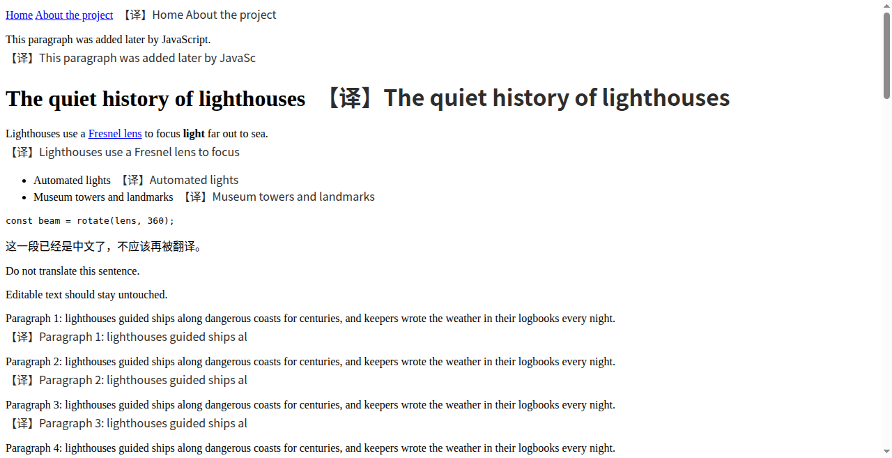
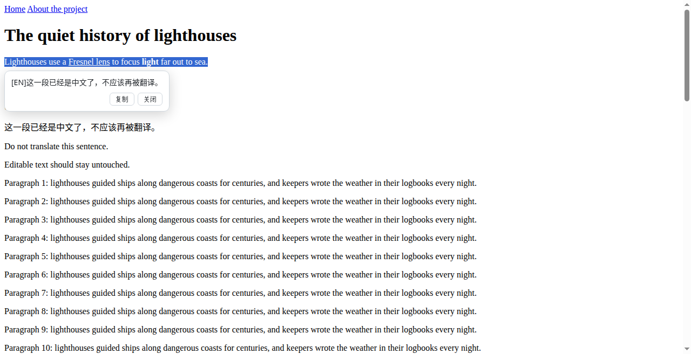

# 双语网页翻译（极简）

[English](README.md)

一个很小的 Chrome 扩展（约 40 KB，无需构建，没有依赖），用**你自己的 OpenAI 兼容大模型接口**来：

- **双语翻译网页**：每段原文下面显示简体中文译文，再点一次切回原文。
- **划词翻译**：选中文字后，右键“翻译选中文字”或按 **Alt+S**，译文显示在选区旁的小窗里。外文译成简体中文，中文译成英文。

设置只有两项：**LLM Provider**（API 地址 + 模型）和 **API Key**。没有账号、统计、远程配置或云同步，扩展只会向你填写的 API 地址发请求。

| 网页翻译 | 划词翻译 |
|---|---|
|  |  |

<sub>截图来自离线自动测试，“译文”是模拟接口返回的占位文字。</sub>

## 安装

扩展没有上架 Chrome 网上应用店，需要以“已解压的扩展程序”方式加载（Chrome 或其他 Chromium 内核浏览器，116 及以上版本）：

1. 获取代码，任选一种：
   - 克隆本仓库；
   - 从 Releases 下载 `minimal-bilingual-translate-<版本>.zip` 并解压。

   请把目录放在**固定位置**。Chrome 每次启动都从这个目录加载扩展，删除或移动后扩展就会失效。
2. 打开 `chrome://extensions`，打开右上角的“开发者模式”。
3. 点“加载已解压的扩展程序”，选择 **`extension`** 目录（里面直接有 `manifest.json`）。
4. 可选：把图标固定到工具栏（拼图图标 → 图钉）。

**升级**：把新版文件覆盖到同一个 `extension` 目录，然后在 `chrome://extensions` 里点本扩展的“重新加载”。设置和 key 都会保留，因为未打包扩展的 ID 由目录路径决定。

## 配置

第一次点图标会自动打开设置页，以后也可以右键图标 →“选项”打开。

| 项 | 填写 |
|---|---|
| 服务商 | 选一个预设，或选“自定义” |
| API 地址 | OpenAI 兼容地址，填到 `/v1` 或服务商给的根地址即可，扩展会自动补上 `/chat/completions`；直接填以 `/chat/completions` 结尾的完整地址也可以 |
| 模型 | 服务商提供的模型名 |
| API Key | 你的 key；不需要 key 的本地服务可以留空 |

预设：

| 预设 | API 地址 | 默认模型 |
|---|---|---|
| DeepSeek | `https://api.deepseek.com` | `deepseek-flash` |
| OpenAI | `https://api.openai.com/v1` | `gpt-4o-mini` |
| OpenRouter | `https://openrouter.ai/api/v1` | （需填写） |
| Ollama（本机） | `http://localhost:11434/v1` | （需填写） |

其他实现了 `POST /chat/completions` 的接口（vLLM、llama.cpp server、LM Studio 及其他服务商）都可以用“自定义”接入。

点“保存”时，Chrome 会弹窗请求访问**该 API 地址所在域名**的权限，选“允许”。再点“测试连接”，看到“连接成功”和一句中文译文就说明配置正确。

各服务商的注意事项：

- **DeepSeek**：V4 系列模型默认开启思考模式。翻译不需要思考，开着只会更慢、更费输出 token，所以扩展对 `api.deepseek.com` 的请求会加上 `"thinking": {"type": "disabled"}`。其他服务商的请求不带这个字段。
- **Ollama**：默认会拒绝来自扩展的请求，需要先设置 `OLLAMA_ORIGINS=chrome-extension://*` 再启动 Ollama。
- **推理模型**：解析回复前会去掉 `<think>…</think>` 块和 Markdown 代码块标记。

## 使用

| 操作 | 方法 |
|---|---|
| 翻译当前网页 | 点工具栏图标，或按 **Alt+A** |
| 隐藏 / 重新显示译文 | 再点一次图标（或按 Alt+A） |
| 划词翻译 | 选中文字后右键 →“翻译选中文字”，或按 **Alt+S** |
| 关闭划词小窗 | 点“关闭”、按 **Esc** 或点击小窗外面；点“复制”可复制译文 |

- 只翻译屏幕附近的段落，向下滚动时继续翻译；页面后来加载的内容也会被翻译。
- 不翻译代码块、表单输入框、可编辑区域、已经是中文的段落，以及标了 `translate="no"` 或 `.notranslate` 的内容。
- 请求失败时右上角会出现红色提示，例如 `HTTP 401` 表示 key 被拒绝。改好设置后，在页面上按两次图标重试。
- **快捷键**：可在 `chrome://extensions/shortcuts` 修改。升级后如果 Alt+S 没反应，请在那里手动设置一下，因为 Chrome 不一定会自动分配新版本新增的快捷键。如果其他扩展也占用了 Alt+A，给其中一个换个键。
- Chrome 不允许扩展在 `chrome://` 页面和 Chrome 网上应用店页面上运行。

## 隐私与权限

| 权限 | 用途 |
|---|---|
| `activeTab` + `scripting` | 只在你点图标、用右键菜单或按快捷键的那个标签页里注入翻译脚本，其他页面上什么都不运行 |
| `storage` | 把设置和 key 保存在 `chrome.storage.local` 中，不会同步到 Google 账号 |
| `contextMenus` | 右键菜单里的“翻译选中文字” |
| 可选主机权限 | 只在保存或测试设置时，申请访问你的 API 所在域名 |

- key 只会以 `Authorization: Bearer <key>` 的形式发给你配置的 API 地址。
- 要翻译的网页文字会发送给该 API，请选择你信得过的服务商。
- 扩展没有自动运行的内容脚本，也不申请访问所有网站的权限。

## 工作原理

```
extension/
├── manifest.json   MV3 清单
├── background.js   Service Worker：按需注入脚本；唯一的 fetch()（发往你的 API）；缓存和并发限制
├── content.js      网页翻译：找出文本块，按需分批翻译，插入译文
├── selection.js    划词小窗（Shadow DOM）
├── options.html/js 设置页
└── icons/
```

- `content.js` 遍历页面上的文本节点，按最近的块级元素分组；块接近视口时（`IntersectionObserver`）才加入翻译队列。每批最多 16 段、3000 字符。`MutationObserver` 会发现页面后来加入的内容。译文用 `textContent` 写入 `<font class="mt-tr">` 元素，不会被当作 HTML 解析。切换原文就是在 `<html>` 上加或去掉一个 class。
- `background.js` 把每批文字作为 JSON 数组放在 user 消息中，要求模型返回等长的 JSON 数组。如果回复不符合这个格式，就逐条重新翻译。同时最多发 4 个请求；内存中最多缓存 3000 条译文，缓存键包括 API 地址、模型、目标语言和原文。
- Service Worker 只接受扩展自身脚本发来的翻译请求。只有设置页可以测试尚未保存的配置；网页里运行的脚本始终使用已保存的配置。

## 开发

无需构建：修改 `extension/` 下的文件后，在 `chrome://extensions` 点“重新加载”即可。

### 测试

`test/run.sh` 会在无界面 Chrome 中运行离线端到端测试，共 23 项检查。脚本先启动一个模拟的 OpenAI 兼容接口（`test/mock_openai.py`）和一个静态测试网站（`test/site/`），再通过 Chrome DevTools Protocol 控制浏览器。检查内容包括：网页翻译与切换、按需翻译、划词翻译、格式不符时逐条重试、错误提示、设置页、各服务商的专属请求字段，以及**没有任何请求离开本机**。

运行环境：Python 3、Node.js 22 或更高版本（需要内置的 `WebSocket`），以及 **Chrome for Testing 或 Chromium**。品牌版 Google Chrome 从 137 起忽略 `--load-extension`，不能用于测试。

```bash
# 例如使用 Playwright 安装的 Chrome for Testing：
test/run.sh ~/.cache/ms-playwright/chromium-*/chrome-linux64/chrome
```

结果和截图写入 `test/out/`，全部通过时退出码为 0。需要本机 127.0.0.1 的 18080 和 18081 端口空闲。为了在容器中也能运行，测试启动 Chrome 时加了 `--no-sandbox`。测试只用了模拟接口，不代表任何真实服务商的行为。

### 打包

```bash
scripts/package.sh   # 生成 dist/minimal-bilingual-translate-<版本>.zip 和 .sha256
```

### 图标

`tools/make_icons.py` 用 Pillow 和 Noto Sans CJK 字体生成 `extension/icons/*.png`：`python3 tools/make_icons.py extension/icons [字体.ttc]`。

## 已知限制

- 界面只有中文。网页翻译的目标语言固定为简体中文；选中的中文固定译成英文。
- 网页翻译不会进入 iframe 和 Shadow DOM。
- 如果一个元素既有自己的文字又包含子段落，它自己的那部分文字不会被翻译。
- 翻译质量和速度取决于你选用的模型。

## 许可证

[MIT](LICENSE)
